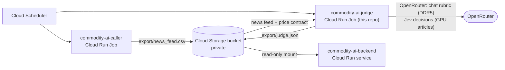

# Commodity AI — news judge

Reads this month's hardware news and scores the **price pressure** it implies for next month's DDR5 and consumer GPU
retail prices, using an LLM with an eight-dimension rubric (supply, demand, disruption, scope, duration, category,
certainty, impact confidence). The daily job writes `export/judge.json` to the shared bucket, and
[commodity-ai-backend](https://github.com/MobyDIGG-commidtyAI/commodity-ai-backend) shows it next to the price evidence.

The score is signed (positive = upward pressure) with a direction: `UP` at +0.5 or more, `DOWN` at −0.5 or less, otherwise
`FLAT` (abstain). **It is not a calibrated price forecast**; the backtests in [docs/research.md](docs/research.md) do not yet
show predictive accuracy. The rubric and its sources: [docs/rubric.md](docs/rubric.md).

## Architecture



## One daily run (`scripts/cloud_job.sh`)

1. Copy `judgments.sqlite3` and the article cache from the bucket (`$DATA_MOUNT/judge/`) to local disk.
2. `python -m hardware_signal.cli daily`:
   - **DDR5:** the month's RAM headlines from the live news feed (up to `MAX_ARTICLES`), one chat call to `OPENROUTER_MODEL`.
   - **GPU:** fetch up to 40 linked GPU articles (cached), keep dated readable text, judge the newest 8 with the GPU Jev rubric
     (one Decisions API call each).
3. Write `judge.json` (schema below) to `$DATA_MOUNT/export/`; save the database and cache back.
4. Exit 3 when one category failed (the other is still published), so the job execution shows the failure.

```json
{"schema_version": 1, "generated_at": "...", "news_month": "2026-10",
 "items": {"DDR5": {"status": "SCORED", "as_of_month": "2026-10", "target_month": "2026-11", "direction": "FLAT",
                    "pressure": 0.21, "articles_considered": 20, "articles_judged": 20, "model": "...",
                    "evidence": [{"title": "...", "source": "...", "date": "...", "url": "...", "contribution": 0.12}]},
           "GPU": {"status": "NO_TEXT", "...": "..."}},
 "limitations": ["..."]}
```

`status` is `SCORED`, `NO_NEWS` / `NO_TEXT` (nothing to judge) or `ERROR` (details in the job log).

## Configuration

| Variable | Cloud Run Job | Local default |
|---|---|---|
| `OPENROUTER_API_KEY` | Secret Manager secret | `.env` |
| `OPENROUTER_MODEL` | e.g. the team's chosen `author/model` slug | `.env` |
| `DATA_MOUNT` | `/mnt/tank` (bucket mount, read-write) | unset: plain local run |
| `DATA_DIR` | `$DATA_MOUNT/partner/chin-2026-10-15` (set by the job script) | `dataset/chin` |
| `NEWS_FEED` | `$DATA_MOUNT/export/news_feed.csv` (set by the job script) | `dataset/ohm/news_feed.csv` |
| `MAX_ARTICLES` | `20` | `20` |

No third-party Python packages are needed.

## Run locally

```bash
cp .env.example .env    # add OPENROUTER_API_KEY and OPENROUTER_MODEL; point DATA_DIR / NEWS_FEED at local copies
PYTHONPATH=src python -m hardware_signal.cli daily --output output/judge.json
```

The research commands (case export, backtests, evaluation, HTTP API) are described in [docs/research.md](docs/research.md).

## Test

```bash
pip install pytest && python -m pytest -q
```

Tests that need the team dataset (a teammate's price contract and news archive, kept private) are skipped unless
`DATA_DIR` / `NEWS_FEED` point at a copy.

## Deploy (Google Cloud)

```bash
gcloud run jobs deploy cai-judge --region <REGION> --image <IMAGE> \
  --set-env-vars DATA_MOUNT=/mnt/tank,OPENROUTER_MODEL=<author/model> \
  --set-secrets OPENROUTER_API_KEY=<secret-name>:latest \
  --add-volume name=tank,type=cloud-storage,bucket=<BUCKET> --add-volume-mount volume=tank,mount-path=/mnt/tank \
  --memory 512Mi --cpu 1 --task-timeout 30m --max-retries 0
```

Schedule it after the caller job (for example 09:45 Asia/Bangkok). Cost: about 1 chat call plus up to 8 Jev calls a day.

## License

MIT
